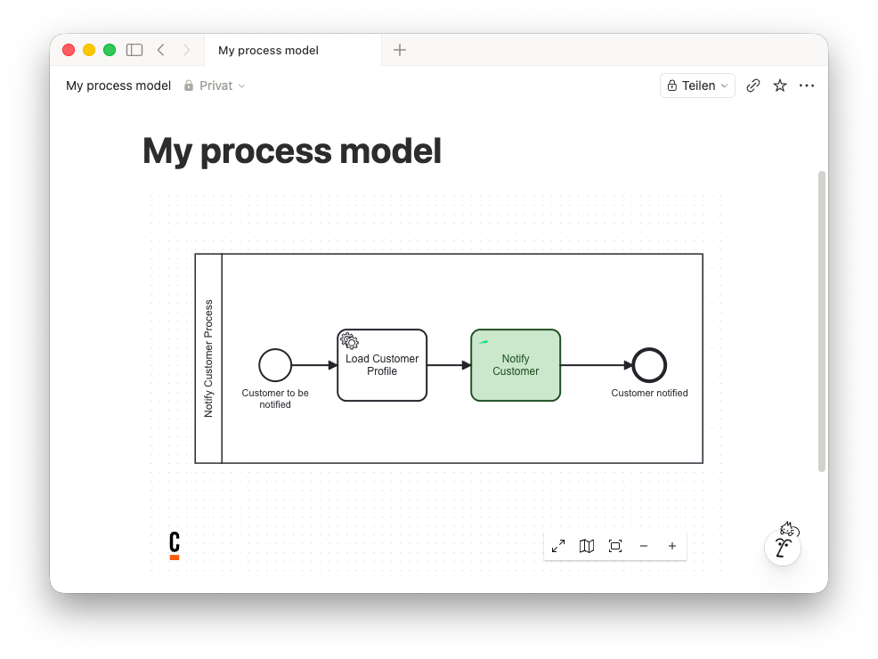

# Camunda Diagram Notion Embed

**Show your Camunda Web Modeler diagrams live in Notion, not as screenshots.**

A free web page that turns a Camunda Web Modeler share link into a URL you paste into a Notion embed block.

## Why

Notion cannot embed a Camunda diagram on its own, so process docs end up with screenshots that go stale the moment the model changes. This tool closes that gap with a live embed.

## What you get

- **Always current.** Edits in the modeler show up the next time the Notion page opens, as long as the share link exists.
- **Zoom and pan.** Readers explore the diagram right in the page.
- **Nothing to install.** Readers need no Camunda account, and the tool stores nothing.

## Get started

1. In Camunda Web Modeler, open your diagram, choose **Share** from the menu in the top right, click **Create link**, then **Copy**, not **Embed** ([Camunda docs](https://docs.camunda.io/docs/components/modeler/web-modeler/collaboration/)).
2. Open [the tool](https://miragon-camunda-diagram-notion-embed.netlify.app), paste the link, click **Generate**, then **Copy**.
3. In Notion, type `/embed`, paste the copied URL and click **Embed link**: the diagram appears in your page.

Anyone who has the share link can see the diagram, whatever your Notion permissions are. Check the link in a private browser window first: if Camunda asks you to sign in, the embed stays empty.

## Help and feedback

- **Bugs and ideas:** [open an issue](https://github.com/Miragon/camunda-diagram-notion-embed/issues).
- **Security:** report vulnerabilities privately via [SECURITY.md](SECURITY.md).

## Contributing

Developer setup is in [CONTRIBUTING.md](CONTRIBUTING.md). We currently do not accept pull requests from outside the team; please open an issue instead.

## Credits

Inspired by [drawio-notion-embed](https://github.com/ivankahl/drawio-notion-embed) by Ivan Kahl.

## License

[MIT](LICENSE) © Miragon GmbH
